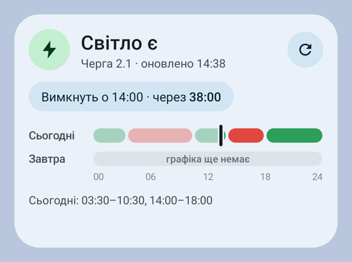
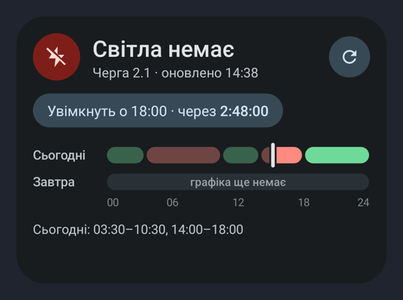
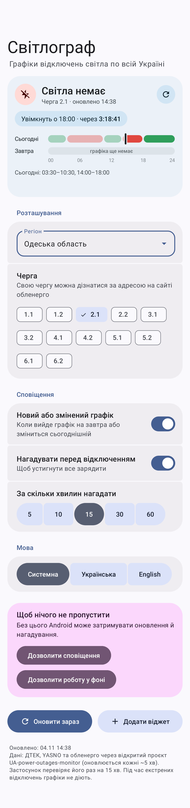
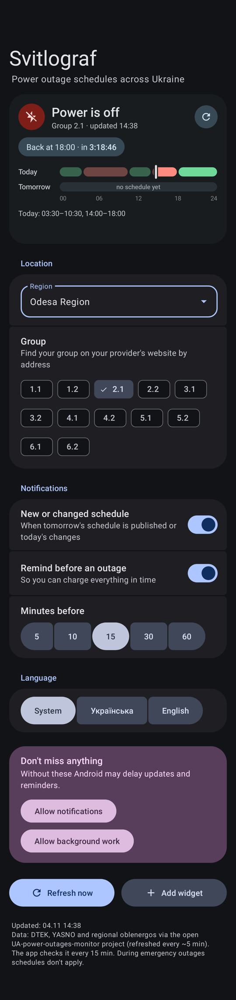

# Світлограф · Svitlograf

[Українська](#українська) · [English](#english)

<p>
  
  
</p>

---

## Українська

Android-віджет із графіком стабілізаційних відключень світла для вашого регіону та черги.

**Що вміє**

- Показує, чи є зараз світло, і веде живий відлік до найближчого вимкнення або увімкнення.
- Малює графік на сьогодні й завтра з позначкою «зараз».
- Підтримує всі регіони, що є в джерелі даних: обираєте регіон і чергу в застосунку.
- Надсилає сповіщення, коли вийшов графік на завтра або змінився сьогоднішній.
- Нагадує за 5–60 хвилин до вимкнення.
- Попереджає про екстрені відключення, коли графіки не діють.
- Світла й темна тема, кольори Material You зі шпалер (Android 12+), дизайн Material 3 Expressive.
- Українська та англійська мови, вибір мови в застосунку.

**Встановлення**

1. Завантажте APK зі сторінки [Releases](../../releases) або зі збірки в [Actions](../../actions).
2. Відкрийте застосунок, оберіть регіон і чергу.
3. Дозвольте сповіщення та роботу у фоні (на Xiaomi/MIUI це обов'язково).
4. Додайте віджет на робочий стіл. Найкраще виглядає розмір 4×3; на меншому віджет ховає список інтервалів і графік на завтра.

**Звідки дані**

Графіки беруться з відкритого проєкту [UA-power-outages-monitor](https://github.com/chaichuk/UA-power-outages-monitor), який кожні ~5 хвилин збирає їх із сайтів ДТЕК, YASNO та обленерго. Застосунок перевіряє його раз на 15 хвилин (близько 7 КБ трафіку). Якщо джерело відстане, час оновлення на віджеті стане з позначкою ⚠. У разі сумнівів звіряйтеся з офіційним сайтом або ботом свого обленерго.

**Обмеження**

- Коли телефон довго лежить без діла, Android може відкладати фонові перевірки, тож сповіщення про новий графік інколи приходить із запізненням. Нагадування перед вимкненням прив'язані до точного будильника.
- Під час екстрених відключень графіки не діють.

---

## English

An Android home-screen widget showing the rolling power outage schedule for your region and group in Ukraine.

**Features**

- Shows whether the power is on right now, with a live countdown to the next switch.
- Draws today's and tomorrow's schedule with a "now" marker.
- Works for every region in the data source: pick your region and group in the app.
- Notifies you when tomorrow's schedule is published or today's changes.
- Reminds you 5–60 minutes before an outage.
- Warns about emergency outages, when schedules don't apply.
- Light and dark themes, Material You colours from your wallpaper (Android 12+), Material 3 Expressive design.
- Ukrainian and English, with an in-app language switch.

**Install**

1. Download the APK from [Releases](../../releases) or from a build in [Actions](../../actions).
2. Open the app and choose your region and group.
3. Allow notifications and background work (required on Xiaomi/MIUI).
4. Add the widget to your home screen. 4×3 looks best; smaller sizes hide the interval list and tomorrow's bar.

**Data source**

Schedules come from the open [UA-power-outages-monitor](https://github.com/chaichuk/UA-power-outages-monitor) project, which collects them from DTEK, YASNO and regional oblenergo websites every ~5 minutes. The app checks it every 15 minutes (about 7 KB per check). If the source falls behind, the widget marks the update time with ⚠. When in doubt, check your provider's official site or bot.

**Limitations**

- When the phone sits idle, Android may defer background checks, so a new-schedule notification can arrive late. Pre-outage reminders use exact alarms.
- During emergency outages schedules don't apply.

<p>
  
  
</p>

---

## Build

Requires JDK 17+ and the Android SDK (compileSdk 35).

```sh
./gradlew testDebugUnitTest   # logic tests + widget/app renders in app/build/renders
./gradlew assembleRelease
```

Release signing reads `keystore.properties` (see `keystore.properties.example`). Without it the release build is signed with the debug key. The keystore is not in the repository.

Min Android 8.0 (API 26). Package: `app.svitlograf`.
